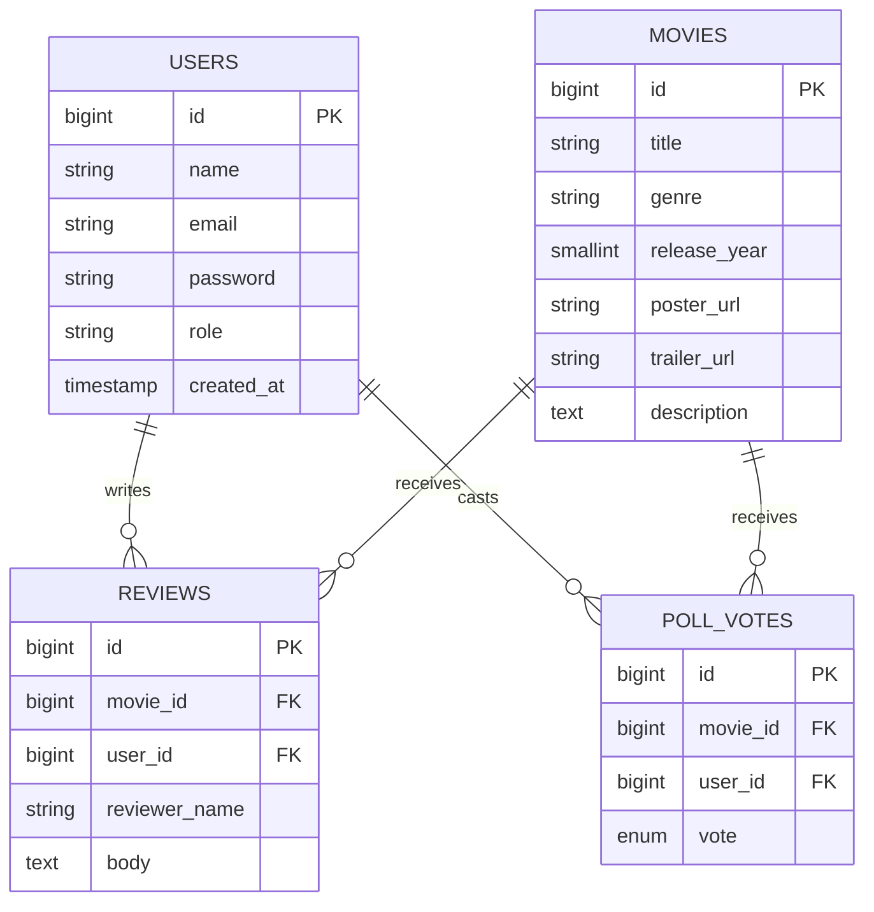
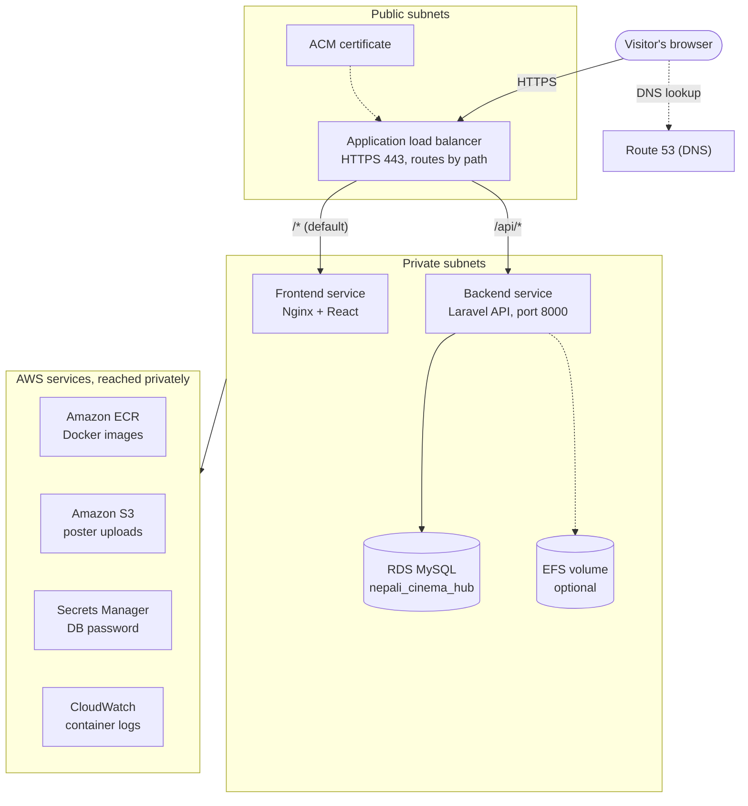
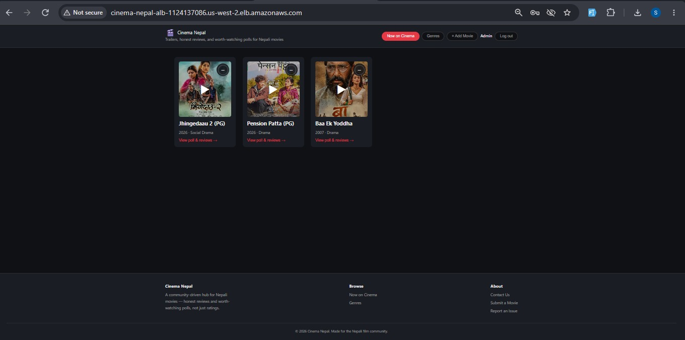
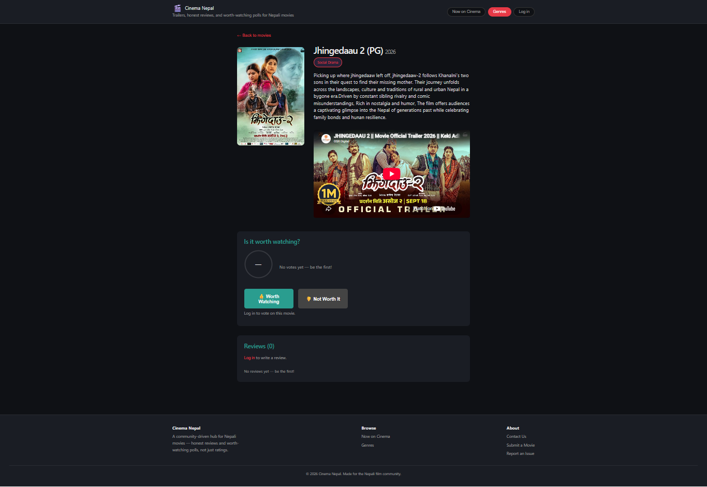
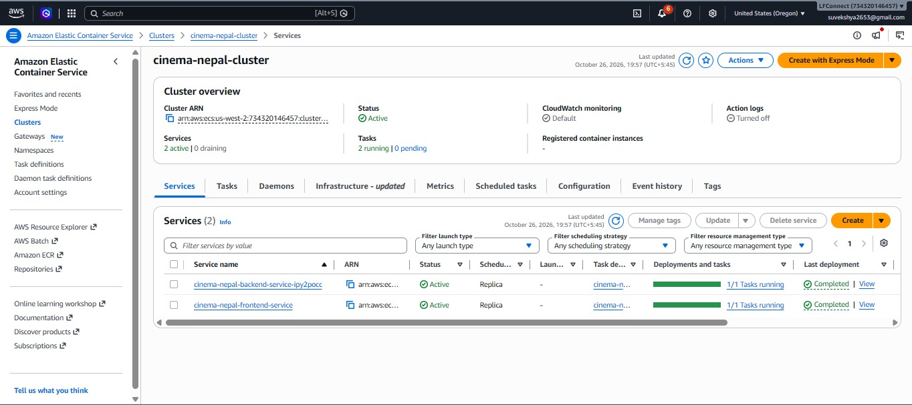
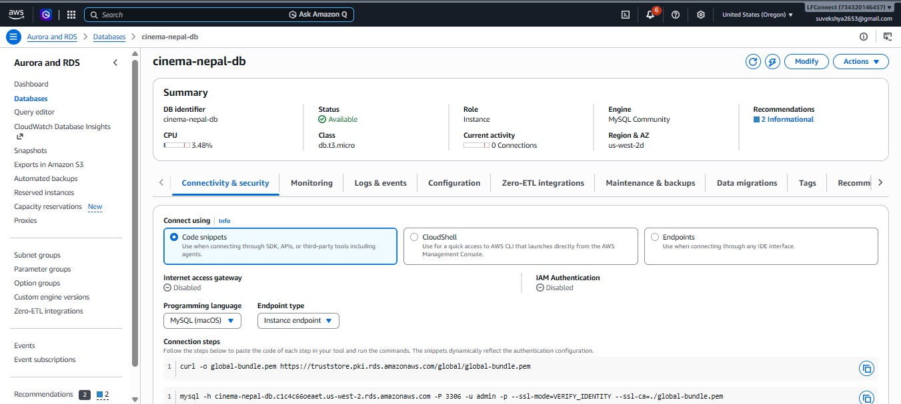
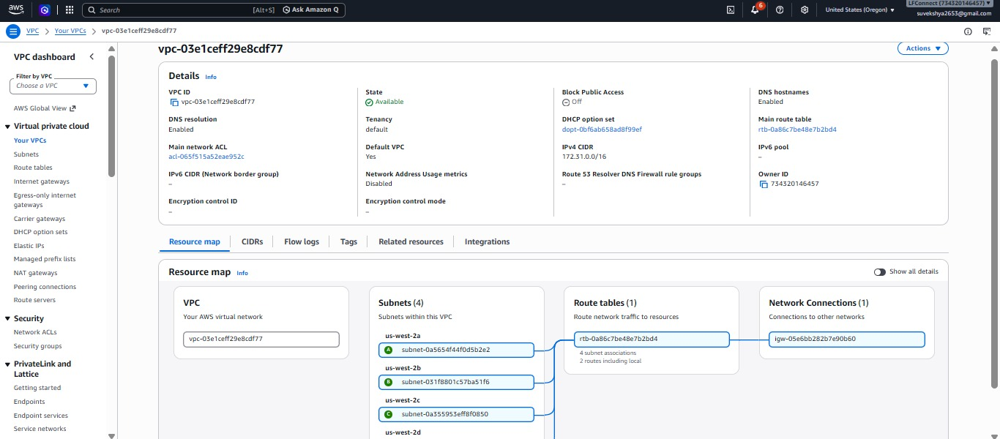
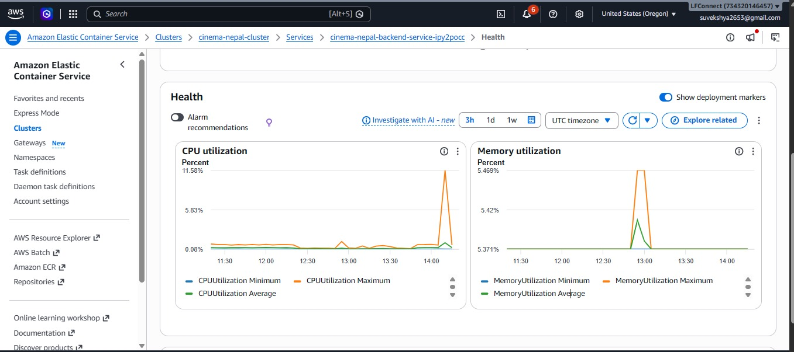

# Cinema Nepal

A community-driven hub for Nepali movies — honest reviews and worth-watching polls, not just ratings.

## Features

- Browse movies currently on cinema and by genre
- Community reviews on each movie
- "Worth watching?" polls (worth / not worth)
- Admin login to manage movie listings, with poster uploads stored on S3

See the [roadmap](#roadmap) for planned features.

## Tech stack

| Layer | Technology |
|---|---|
| Frontend | React (Vite), served via Nginx |
| Backend | Laravel (PHP 8.2) |
| Database | MySQL 8 |
| File storage | Amazon S3 |
| Containerization | Docker, multi-stage builds |
| Hosting | AWS (ECS Fargate, RDS, ALB, ECR, S3, IAM) |

## Entity-relationship diagram

Core tables: `users`, `movies`, `reviews`, and `poll_votes`. Reviews and poll votes can optionally be tied to a logged-in user (nullable `user_id`), so anonymous submissions are also supported.


## AWS architecture

The app runs as two independently deployed services on **ECS Fargate** in `us-west-2`, behind a single **Application Load Balancer (ALB)** with path-based routing. A managed **RDS MySQL** database stores the data, **S3** stores poster uploads, and everything except the load balancer sits in private subnets.



### How it works

- **Route 53** points the domain name at the load balancer.
- **ACM certificate** provides free HTTPS. It is attached to the load balancer's port 443 listener, and port 80 redirects to HTTPS.
- **Application load balancer** is the only public entry point. Path rules send `/api/*` to the backend and everything else to the frontend, so the browser talks to one address and the frontend calls the API with relative `/api` URLs.
- **ECS Fargate** runs the frontend (Nginx serving the React build) and the backend (Laravel on PHP 8.2, listening on port 8000) as serverless containers in private subnets — no EC2 instances to patch or manage. Each service scales its task count independently.
- **ECR** (Elastic Container Registry) stores the Docker images built locally and pushed via `docker push`. ECS pulls from here on every deployment.
- **RDS MySQL** is a managed database instance in private subnets. Only the backend task's security group is allowed to reach it on port 3306.
- **S3** stores poster images uploaded through the admin panel. The backend task authenticates to S3 using an **IAM task role** (`cinema-nepal-ecs-task-role`), not hardcoded AWS keys, so credentials are short-lived and scoped to just this task.
- **Secrets Manager** holds the database password and injects it into the backend task, so it is not stored in plain text in the task definition.
- **CloudWatch** collects the container logs.
- **EFS volume (optional)** is only needed if Laravel must keep files written to `storage/` across restarts. Uploads already go to S3.
- **Security groups** enforce the boundaries: the load balancer accepts web traffic from the internet, the tasks accept traffic only from the load balancer, and RDS accepts MySQL traffic only from the backend.


## 📸 Production Screenshots & Proof of Deployment

### Web Application UI
<p align="center">
  
  
  

</p>

### AWS Infrastructure & Monitoring
<p align="center">
  
  
</p>

<p align="center">
  
  
</p>


### Why one load balancer with path routing

The frontend and backend still deploy, scale, and health-check independently, but they share one load balancer. This costs less than running one per service, avoids exposing a separate backend port, and lets the whole site use one HTTPS certificate on one domain. It also avoids mixed-content errors, which happen when an HTTPS page calls an HTTP backend address.

### Why S3 instead of local disk

Early on, poster uploads were saved to the container's local filesystem and served via a `storage:link` symlink. That worked until the ECS service was scaled down and back up — the new container started fresh with none of the previously uploaded files, since nothing outside of RDS was actually persistent. Moving uploads to S3 fixes this: images now survive deployments, restarts, and scaling events, because they live outside the container entirely.

## Local development

```bash
git clone https://github.com/suvkshyaa/Cinema-Nepal.git
cd Cinema-Nepal
cp .env.example .env
docker compose up --build
```

- Frontend: http://localhost:5173
- Backend API: http://localhost:8000/api
- MySQL: localhost:3307 (mapped to avoid clashing with local installs)

Locally, poster uploads still use the `public` disk by default. Set `AWS_BUCKET`, `AWS_DEFAULT_REGION`, `AWS_ACCESS_KEY_ID`, and `AWS_SECRET_ACCESS_KEY` in `.env` if you want to test against S3 locally too.

## Deployment

The production images are built and pushed to ECR manually. Replace `<account-id>` with your AWS account ID.

### Backend

```bash
aws ecr get-login-password --region us-west-2 | docker login --username AWS --password-stdin <account-id>.dkr.ecr.us-west-2.amazonaws.com

docker build -t cinema-nepal-backend ./backend
docker tag cinema-nepal-backend:latest <account-id>.dkr.ecr.us-west-2.amazonaws.com/cinema-nepal-backend:latest
docker push <account-id>.dkr.ecr.us-west-2.amazonaws.com/cinema-nepal-backend:latest
```

Then force a new ECS deployment to pick up the new image:

```bash
aws ecs update-service \
  --cluster cinema-nepal-cluster \
  --service cinema-nepal-backend-service-ipy2pocc \
  --force-new-deployment \
  --region us-west-2
```

### Frontend

Because the load balancer routes `/api/*` to the backend, the frontend calls the API with a relative URL. Pass it as a build arg:

```bash
docker build --build-arg VITE_API_URL=/api -t cinema-nepal-frontend ./frontend
docker tag cinema-nepal-frontend:latest <account-id>.dkr.ecr.us-west-2.amazonaws.com/cinema-nepal-frontend:latest
docker push <account-id>.dkr.ecr.us-west-2.amazonaws.com/cinema-nepal-frontend:latest

aws ecs update-service \
  --cluster cinema-nepal-cluster \
  --service cinema-nepal-frontend-service \
  --force-new-deployment \
  --region us-west-2
```

The force-new-deployment step pulls the new image only if the task definition references the same tag you pushed (for example `latest`).

### Required backend environment variables

| Variable | Purpose |
|---|---|
| `APP_KEY` | Laravel encryption key |
| `DB_HOST`, `DB_DATABASE`, `DB_USERNAME` | RDS connection |
| `DB_PASSWORD` | RDS password, injected from Secrets Manager (not stored in plain text) |
| `AWS_BUCKET`, `AWS_DEFAULT_REGION` | S3 bucket for poster uploads (credentials come from the ECS task role, not env vars) |

## Creating the admin user

The project includes an `AdminSeeder` that creates a default admin. Do not use its default credentials in production. Create your own admin with a strong password instead, for example from a shell in the running backend task (ECS Exec) using `php artisan tinker`, and hash the password with `Hash::make`.

## Security notes

- Never commit `.env` or any file containing passwords, keys or tokens. Keep `.env` in `.gitignore`.
- Do not paste secrets into issues, screenshots or documentation. If a secret is ever exposed, change it.
- Use a strong, unique password for the admin account and for the RDS database.
- Keep the database password in Secrets Manager rather than plain environment variables.
- Only the load balancer should be reachable from the internet. Tasks and the database stay in private subnets.

## Roadmap

Planned ideas, not yet built:

- Search by title, filters by year or decade, and sorting
- Trailer embeds on each movie page (the `trailer_url` field already exists)
- Support for older Nepali films, so any movie can be found and rated
- Movie anniversaries (needs a full `release_date` instead of only `release_year`)
- Automated builds and deployments instead of manual pushes

## Project status

**Last updated:** October 2026

Cinema Nepal is deployed on AWS and working end to end. The infrastructure is being improved step by step.

| Area | Status |
|---|---|
| Frontend (React + Nginx on ECS Fargate) | Live |
| Backend (Laravel API on ECS Fargate) | Live |
| Database (RDS MySQL) | Live |
| Poster uploads (S3 with IAM task role) | Live |
| Docker images (ECR) | Live |
| Single load balancer with path routing | Live |
| HTTPS and custom domain | Live |
| Secrets Manager for the database password | Planned |
| Search, filters and trailer embeds | Planned |
| Automated builds and deployments | Planned |

Currently the frontend and backend each have their own load balancer over HTTP. The architecture section below describes the target design.